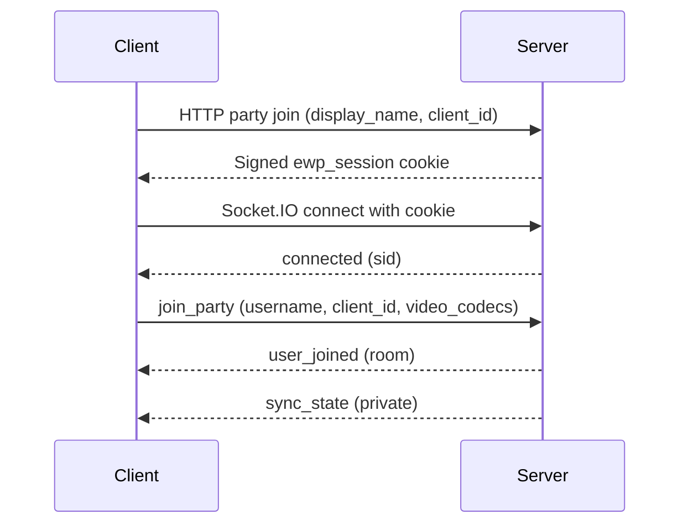

# Socket.IO API (3.0)

Real-time API for Emby Watch Party 3.0, with Emby and Jellyfin providers. The backend uses `python-socketio.AsyncServer`; the frontend uses `socket.io-client`. Use a compatible Socket.IO client, not raw WebSocket JSON.

The application contract contains **21 inbound events** and **38 outbound events**. Socket.IO built-ins such as `connect`, `disconnect`, and `connect_error` are separate from those application events.

## Contracts and conventions

- [Python models and event registry](../backend/src/socket_protocol.py) define validated payloads.
- [Generated JSON schema](../backend/socket-events.schema.json) and [TypeScript payloads](../frontend/src/types/socket.generated.ts) describe required, optional, and nullable fields.
- [Typed frontend events](../frontend/src/types/socket.ts) add Socket.IO lifecycle callbacks.
- [Server handlers](../backend/src/socket_handlers) define permissions, routing, and state changes.

Inbound validation uses strict types and ignores extra fields. A misspelled optional field can therefore be ignored rather than rejected: socket joins use `username`, not the HTTP field `display_name`. Invalid shapes emit private `error { message: 'Invalid <event> payload' }`.

Outbound validation rejects extra fields and preserves the original wire payload. A schema default does not mean an omitted field is transmitted. Tables below enumerate the complete top-level key sets; consult the schema for types and nested models.

| Term | Meaning |
| --- | --- |
| `sid` | Transient Socket.IO connection ID; changes on reconnect. |
| `client_id` | Persistent browser identity, not an authentication credential. |
| `party_id` | Uppercase room code. Generated dynamic codes have five characters; static IDs are configured separately. Handlers normalize inbound codes. |
| Host | Member whose authenticated media-server account supplies the room's library access and playback credentials. |
| Selector | Persistent `client_id` that selected the current video; can differ from the host. |
| Room broadcast | Sent to the Socket.IO room named by `party_id`; particular producers may exclude a departing/waiting socket. Playback controls explicitly include the sender. |
| Private event | Sent to one `sid`, such as its playback URL, rejection, or drift correction. |
| `time` | Absolute media seconds unless explicitly described as a stream offset. Timestamp strings describe server clock instants, not player positions. |

REST routes, HLS, and the Socket.IO transport use `APP_PREFIX` when configured. FastAPI documentation remains at root `/docs`, `/redoc`, and `/openapi.json`, including on a subpath deployment. A proxy forwarding only the app subpath does not expose those root documentation routes.

## Authentication

HTTP join at `POST ${APP_PREFIX}/api/party/{party_id}/join` establishes the signed party-bound `ewp_session` cookie. Its lifetime follows `SESSION_EXPIRY`, default 86400 seconds. The socket handshake captures that cookie; a later HTTP cookie change does not retroactively update an already connected socket's handshake.

Host login is `POST ${APP_PREFIX}/api/v2/auth/login`. Upstream access tokens remain server-side. Host authority requires the expected identity and the current opaque `host_session_grant`; knowing a public `client_id` or broadcast host ID does not confer that role.

Get personal host/admin roles from `GET ${APP_PREFIX}/api/v2/auth/status`, after binding and successful login. `host_changed.is_admin` describes the room's host account, not the event recipient. Preserve newer socket presence and discard superseded HTTP responses during recovery. A valid host cookie can report `is_host: true` while presence is still being restored and `party_unlocked` is false. The [auth store](../frontend/src/stores/auth.ts) handles these races and rechecks roles after login completes.

| Room state | Media behavior |
| --- | --- |
| UNLOCKED | Host present. Library and new selections are available, subject to event-specific permissions. |
| PLAYING-ONLY | Host absent during active playback. Existing video and personal stream changes can use the retained token; new selections are refused. |
| LOCKED | No usable host token. Protected media/library calls cannot proceed; chat and room membership can remain available. |

A disconnect marks the host absent and locks library access immediately. The five-second `HOST_GRACE_SECONDS` delays notification/full host cleanup, not the initial lock. With no active video, grace expiry clears the host. During active playback, the retained PLAYING-ONLY host can reclaim even after five seconds while the cookie/grant still matches and no takeover has occurred.

Explicit `/api/v2/auth/logout` clears the host token/grant and registered playback plans immediately while retaining room membership. It differs from disconnect or socket leave, which can retain host credentials for existing playback.

## Connection lifecycle

### `connect` (lifecycle)

The transport path is `${APP_PREFIX}/socket.io`. The origin policy and connection rate limit can refuse a connection. Missing/stale cookies alone do not: room identity, host proof, and protected HTTP access have separate checks.

An accepted socket receives private `connected { sid }`. It must emit `join_party` to enter the room. A transport connection is not proof of room membership or media access.

Connection throttling uses built-in `connect_error`, with a message and `data: { code: 'rate_limited', retry_after: <seconds> }`. This is distinct from the application's chat-only `rate_limited` event.

### Initial HTTP binding and socket join

The HTTP body uses `display_name`; the socket payload uses `username`. Persist the same client ID across refreshes and send a conservative codec report unless actual capability detection provides more.

```js
import { io } from 'socket.io-client'

const prefix = '' // Match APP_PREFIX.
const partyId = 'K7N2F'
const username = 'andrew'
let clientId = localStorage.getItem('my-watchparty-client-id')
if (!clientId) {
  clientId = crypto.randomUUID()
  localStorage.setItem('my-watchparty-client-id', clientId)
}

const response = await fetch(`${prefix}/api/party/${partyId}/join`, {
  method: 'POST',
  credentials: 'same-origin',
  headers: { 'Content-Type': 'application/json' },
  body: JSON.stringify({ client_id: clientId, display_name: username }),
})
const joined = await response.json()
if (!response.ok || !joined.success) throw new Error(joined.message || 'Join failed')

const socket = io(location.origin, { path: `${prefix}/socket.io`, autoConnect: false })
socket.on('connect', () => {
  socket.emit('join_party', {
    party_id: partyId,
    client_id: clientId,
    username,
    video_codecs: ['h264'], // Use actual detection to advertise other supported codecs.
  })
})
socket.on('sync_state', applyServerState)
socket.on('error', showServerError)
socket.on('join_rejected', showJoinRejection)
socket.connect()
```

Implement the three application callbacks shown above. Register listeners before connecting. This is a minimal same-origin join pattern; external clients also need vote, reconnect, session failure, and retry handling.

### `disconnect` (lifecycle)

An unexpected disconnect removes the live socket, stops its individual stream, revokes its HLS token, updates ready/vote state, and broadcasts membership changes. It retains the participant identity for a recognized rejoin.

If a dynamic room becomes empty unexpectedly, it gets a **30-second** empty-room grace before cleanup. A rejoin can cancel that cleanup. Static rooms survive empty cleanup; their configuration can recreate them after process restart, but live playback, grants, and members are not restored.

### Reconnect (client responsibility)

A reconnected socket has a fresh `sid` and must emit `join_party` again with its persistent identity, name, avatar, and codec report. The bundled listener is in [usePartyReconnect.ts](../frontend/src/composables/usePartyReconnect.ts), with initial HTTP binding in [stores/party.ts](../frontend/src/stores/party.ts).

Recognized participants skip the normal late-join vote and receive fresh state/stream setup. If the HTTP session must be rebound, complete that flow too; merely reconnecting transport cannot repair expired or superseded media cookies. Refresh the socket handshake if it captured an old cookie.

Explicit leave forgets participant membership and does not receive the unexpected-disconnect grace. Browser tabs share identity/cookies; use separate profiles for independent viewers. Different ports or `APP_PREFIX` values on one hostname do not isolate `ewp_session`.

## Inbound events (client -> server)

Every application event requires `party_id`. Optional means optional in the validation model, not that omitting identity or recovery fields is useful for a production client.

| Event | Required payload keys | Optional payload keys |
| --- | --- | --- |
| `auto_advance_cancel` | `party_id` | None |
| `cancel_video_selection` | `party_id`, `selection_id` | None |
| `change_streams` | `party_id` | `audio_index`, `media_source_id`, `quality`, `subtitle_index` |
| `chat_message` | `party_id`, `message` | `request_id` |
| `heartbeat` | `party_id`, `time` | None |
| `join_party` | `party_id` | `avatar_uuid`, `client_id`, `username`, `video_codecs` |
| `join_vote` | `party_id`, `vote` | None |
| `leave_party` | `party_id` | None |
| `pause` | `party_id`, `time` | None |
| `play` | `party_id`, `time` | None |
| `report_progress` | `party_id`, `time` | None |
| `retry_video_selection` | `party_id`, `selection_id` | None |
| `seek` | `party_id`, `time` | `was_playing` |
| `select_video` | `party_id`, `item_id` | `audio_index`, `binge`, `episode_number`, `item_name`, `item_overview`, `item_type`, `media_source_id`, `production_year`, `quality`, `resume_mode`, `run_time_seconds`, `season_number`, `selection_id`, `series_name`, `start_seconds`, `subtitle_index` |
| `set_binge_watch_active` | `party_id`, `active` | None |
| `set_party_hidden` | `party_id`, `hidden` | None |
| `stop_video` | `party_id` | None |
| `stream_ready` | `party_id` | None |
| `toggle_library` | `party_id`, `show` | None |
| `update_avatar` | `party_id` | `avatar_uuid` |
| `video_ended` | `party_id` | None |

### `join_party`

Use the example above. `username` and `client_id` technically default to empty strings in the model; send a real display name and stable identity for reliable rejoin. `avatar_uuid` is optional. `video_codecs` is allowlisted by the handler; missing/uncertain capability falls back to H.264.

A successful normal join broadcasts `user_joined` and then sends private `sync_state`. A known participant can be marked `rejoin`. A fresh viewer joining active playback may enter a vote instead. At the socket membership cap, the current handler emits `error { message }`, not a `join_rejected { reason: 'party_full' }` payload. `join_rejected` has a message and optional retry delay; there is no `reason` field in that contract.

### `leave_party`

```js
socket.emit('leave_party', { party_id: 'K7N2F' })
```

Explicit leave removes live and remembered membership, stops the viewer's stream, revokes its token, and broadcasts `user_left`. An empty dynamic room is dissolved immediately. Static rooms are retained. If the departing host leaves viewers watching a video, the existing host token can remain for PLAYING-ONLY; otherwise the room locks fully.

Also call `POST ${APP_PREFIX}/api/party/leave` to unbind the HTTP session. Socket leave cannot clear a browser cookie. HTTP unbind removes party/client/display/avatar fields while preserving the opaque host grant; clients must not infer current authority from that retained value.

### `join_vote`

```js
socket.emit('join_vote', { party_id: 'K7N2F', vote: 'yes' })
```

Only eligible existing members vote; `vote` is `yes` or `no`. The server records votes by `sid` and broadcasts display-name tallies. A strict majority resolves immediately. When all eligible votes arrive or the timeout expires without a majority, the selector's vote breaks the tie; missing/abstaining selector defaults to fail.

Pass admits the joiner and restarts the selected video from zero for the room. Failure rejects the joiner and establishes the configured cooldown. Vote eligibility starts from a snapshot; later arrivals do not gain a vote. Disconnect/leave removes departing eligible voters and reevaluates the outcome. A pending joiner reconnect can receive the remaining countdown instead of starting a second vote.

### `update_avatar`

```js
socket.emit('update_avatar', { party_id: 'K7N2F', avatar_uuid: 'avatar-uuid' })
```

Updates the caller's avatar association and broadcasts `members_update`. The image bytes use the HTTP avatar routes; socket messages carry the UUID only.

### `select_video`

Any joined member can select in an UNLOCKED room. Required keys are `party_id` and `item_id`. The selector becomes that caller's persistent client ID.

```js
socket.emit('select_video', {
  party_id: 'K7N2F',
  item_id: 'media-item-id',
  item_name: 'Example Movie',
  item_overview: 'A title from the configured media server.',
  selection_id: 'selection-123',
  media_source_id: 'source-1',
  quality: '1080p-10000',
  audio_index: 0,
  subtitle_index: -1,
  start_seconds: 120,
  resume_mode: 'resume',
})
```

- `audio_index` is nonnegative; `subtitle_index=-1` means subtitles off.
- `resume_mode` is `resume` or `start_over`, default `start_over`. Start-over forces zero even if `start_seconds` is supplied. Resume uses the supplied position, clamped to the source runtime.
- `media_source_id` chooses the initial source/version; each viewer receives a separate playback session and HLS URL.
- `binge`, when supplied, can change the room's setting only for the host while deployment-level binge support is enabled.
- Optional loading metadata includes `production_year`, `run_time_seconds`, `item_type`, `series_name`, `season_number`, and `episode_number`. Selection text is bounded to 512 characters; `selection_id` is bounded to 64 and generated if absent/empty.

An accepted selection emits `video_selection_started` before upstream preparation, stops outgoing streams, and prepares per-viewer streams. Successful viewers receive private `video_selected`; readiness is coordinated with `stream_ready`, `ready_check_update`, and `all_ready`.

A manual selection is not guaranteed to auto-play after readiness. Honor `all_ready.playing`; the binge flow explicitly requests auto-play and can subsequently emit `play { auto_binge: true }`.

### `retry_video_selection`

```js
socket.emit('retry_video_selection', { party_id: 'K7N2F', selection_id: 'selection-123' })
```

Requires a matching failed selection and an unlocked room. The selector or host can retry; any member can do so once the selector has no remaining socket. It reuses the original selection choices. For a partial failure while others keep watching, retry resumes from the current party position and rebuilds streams for everyone.

### `cancel_video_selection`

```js
socket.emit('cancel_video_selection', { party_id: 'K7N2F', selection_id: 'selection-123' })
```

Uses the same ownership rule as retry. Cancelling in-flight preparation clears the room's video and emits `video_selection_cancelled { cleared_video: true }`. Dismissing a stored partial-failure retry offer emits `cleared_video: false`; viewers already watching must keep their video. Local dismissal of a failure display does not require a server event.

### `stop_video`

```js
socket.emit('stop_video', { party_id: 'K7N2F' })
```

Only the current video's selector can stop it. The server clears video/readiness state, stops the room's streams, and broadcasts `video_stopped { message, stopped_by }`. Stopping PLAYING-ONLY playback also clears the retained host context.

### `change_streams`

```js
socket.emit('change_streams', {
  party_id: 'K7N2F',
  audio_index: 0,
  subtitle_index: -1,
  quality: '720p-4000',
  media_source_id: 'source-2',
})
```

Changes only the requesting viewer's version, audio, subtitles, or quality. `media_source_id` is supported; without it the source defaults to the party selection. The room's initial source is not a prohibition on personal version changes. Different cuts can have different runtimes and are not guaranteed to represent the same scene at the same timestamp.

This requires active video and a usable host token and is allowed in UNLOCKED or PLAYING-ONLY. The replacement produces private `streams_changed { video, current_time, was_playing }`, without a room-wide ready check. `current_time` is the actual start offset for that stream and can be clamped when the new source is shorter. There is no fixed recovery-time guarantee.

### `play` / `pause`

```js
socket.emit('play', { party_id: 'K7N2F', time: 1247.5 })
socket.emit('pause', { party_id: 'K7N2F', time: 1247.5 })
```

Any registered member can control playback. The server commits the caller's supplied absolute position and broadcasts to the whole room **including the sender** before upstream reporting. It does not substitute a projected clock for a non-selector's play/pause position. Make client handlers idempotent and avoid duplicate optimistic UI/chat messages.

### `seek`

```js
socket.emit('seek', { party_id: 'K7N2F', time: 1300, was_playing: true })
```

Any registered member can seek. `was_playing` defaults to false. Seeks during an active ready check are ignored.

For a paused seek, the server broadcasts `seek { time, playing: false, username }` including the sender. For a playing seek, it emits, in order, `force_pause_before_seek`, `ready_check_update`, and `seek { playing: true, wait_for_ready: true }` to the whole room. Clients buffer and report `stream_ready`; `all_ready` then supplies the authoritative time and playing state.

### `report_progress`

```js
socket.emit('report_progress', { party_id: 'K7N2F', time: 1300 })
```

Reports progress for the caller's individual media-server session, with no room broadcast. Only the selector's periodic progress updates advance the continuous party clock; that restriction does not apply to explicit play/pause/seek controls. The bundled view reports every ten seconds, and upstream reports have a separate one-per-sid-per-four-seconds throttle.

### `video_ended`

```js
socket.emit('video_ended', { party_id: 'K7N2F' })
```

Only the selector may end the current title; host fallback applies only when no selector is recorded. Completion reporting and room `video_ended { party_id, timestamp }` follow. PLAYING-ONLY completion clears the retained host. Episode completion can queue binge auto-advance instead of leaving the room idle.

### `stream_ready`

```js
socket.emit('stream_ready', { party_id: 'K7N2F' })
```

Marks the caller ready during a readiness cycle. The server sends ready/waiting names and resolves with `all_ready` when expected participants are ready. Departures can remove blockers. Follow `playing` in the result rather than assuming every readiness cycle starts playback.

### `heartbeat`

```js
socket.emit('heartbeat', { party_id: 'K7N2F', time: 1247.3 })
```

The bundled frontend sends heartbeats every five seconds while playing. With active playback, drift greater than three seconds for two consecutive reports produces private `drift_correction { time }`, then resets the strike count. There is no `expected_time` payload field.

### `chat_message`

```js
socket.emit('chat_message', { party_id: 'K7N2F', message: 'Ready to watch', request_id: 'draft-123' })
```

The server looks up the sender's name/avatar and broadcasts accepted messages including the sender. Messages are truncated to 2048 characters. `request_id` is optional correlation for a rate-limit refusal; it is not echoed in the accepted chat broadcast.

### `toggle_library`

```js
socket.emit('toggle_library', { party_id: 'K7N2F', show: true })
```

Host-only room-wide library visibility. Non-hosts are ignored. The resulting broadcast is `toggle_library { show }`. This differs from a viewer opening or dismissing their own local library UI.

### `set_binge_watch_active`

```js
socket.emit('set_binge_watch_active', { party_id: 'K7N2F', active: true })
```

Host-only, with deployment-level `BINGE_WATCH_ENABLED` also required. Broadcasts `binge_watch_state_changed { available, active }`. If support is disabled, the server can send `available: false, active: false` to correct stale controls. Turning the feature off cancels a pending advance.

### `auto_advance_cancel`

```js
socket.emit('auto_advance_cancel', { party_id: 'K7N2F' })
```

Any room member can cancel a pending episode countdown. The server broadcasts `auto_advance_cancelled { by_username }`. With no pending advance it is a no-op.

### `set_party_hidden`

```js
socket.emit('set_party_hidden', { party_id: 'K7N2F', hidden: false })
```

Host-only. Broadcasts `party_visibility_changed { hidden }` to the room. New rooms start hidden. Hidden means unlisted from Active Parties, not password protection: a viewer with the code can still attempt to join.

## Outbound events (server -> client)

Required/optional below means model requirements. Optional fields may also be nullable; consult the schema. The server does not insert defaults into the emitted message.

| Event | Required payload keys | Optional payload keys |
| --- | --- | --- |
| `all_ready` | `time` | `auto_binge`, `playing`, `username`, `wait_for_ready` |
| `auto_advance_cancelled` | None | `by_username` |
| `auto_advance_fired` | `next_item_id`, `next_title` | None |
| `auto_advance_pending` | `next_item_id`, `next_title`, `total_episodes`, `deadline`, `countdown_seconds` | `next_index_number` |
| `binge_finished` | None | `reason`, `season_id`, `series_id` |
| `binge_watch_state_changed` | `available`, `active` | None |
| `chat_message` | `username`, `message`, `timestamp` | `avatar_uuid` |
| `connected` | `sid` | None |
| `drift_correction` | `time` | `auto_binge`, `playing`, `username`, `wait_for_ready` |
| `error` | `message` | None |
| `force_pause_before_seek` | `time` | `auto_binge`, `playing`, `username`, `wait_for_ready` |
| `host_changed` | None | `host_client_id`, `host_username`, `is_admin`, `playing_only`, `previous_host`, `reason`, `unlocked` |
| `host_left` | None | `host_client_id`, `host_username`, `is_admin`, `playing_only`, `previous_host`, `reason`, `unlocked` |
| `host_reclaimed` | None | `host_client_id`, `host_username`, `is_admin`, `playing_only`, `previous_host`, `reason`, `unlocked` |
| `join_rejected` | `message` | `retry_after` |
| `join_vote_pending` | `timeout_seconds`, `eligible_voters`, `required_majority` | None |
| `join_vote_resolved` | `result` | `reason` |
| `join_vote_started` | `username`, `timeout_seconds`, `eligible_voters`, `required_majority` | None |
| `join_vote_update` | `votes`, `remaining` | None |
| `members_update` | None | `members`, `rejoin`, `username`, `users` |
| `party_dissolved` | `party_id`, `reason` | None |
| `party_visibility_changed` | `hidden` | None |
| `pause` | `time` | `auto_binge`, `playing`, `username`, `wait_for_ready` |
| `play` | `time` | `auto_binge`, `playing`, `username`, `wait_for_ready` |
| `rate_limited` | `message`, `action`, `retry_after` | `request_id` |
| `ready_check_update` | None | `ready`, `waiting` |
| `seek` | `time` | `auto_binge`, `playing`, `username`, `wait_for_ready` |
| `streams_changed` | `video`, `current_time`, `was_playing` | None |
| `sync_state` | `playback_state` | `binge_watch`, `current_video`, `hidden`, `pending_auto_advance`, `pending_video_selection`, `users` |
| `toggle_library` | `show` | None |
| `user_joined` | None | `members`, `rejoin`, `username`, `users` |
| `user_left` | None | `members`, `rejoin`, `username`, `users` |
| `video_ended` | `party_id`, `timestamp` | None |
| `video_selected` | `video` | None |
| `video_selection_cancelled` | `selection_id` | `cleared_video` |
| `video_selection_failed` | `selection`, `message` | `affected`, `failed_users` |
| `video_selection_started` | `selection` | None |
| `video_stopped` | `message`, `stopped_by` | None |

### Payload families

- **Membership:** `users` is a list of display names. `members` contains `{ username, avatar_uuid? }` objects. Membership events can carry `rejoin`.
- **Playback state:** `{ playing, time, last_update }`. Times are absolute media seconds; `last_update` is a server timestamp used for projection.
- **Video:** requires `item_id` and `title`; can include `overview`, private `stream_url`, selected audio/subtitle/source/quality, `selected_by`, runtime, item/series/season identifiers, episode counts, and next-item metadata. Treat a stream URL as a credential-bearing value and keep it out of public logs.
- **Pending selection:** requires `selection_id`, `item_id`, `title`, `status`, `selected_by`, `selected_by_username`, and `started_at`. Status is `preparing` or `failed`; metadata and `error` are optional.
- **Timed events:** require `time`; the shared model can also carry `username`, `playing`, `auto_binge`, and `wait_for_ready`. Use the fields the particular producer sends rather than assuming all appear.
- **Host events:** optional host name/client ID, host-account `is_admin`, lock state, departure reason, previous host, and playing-only flag. These describe room context, not proof of the recipient's role.

### `sync_state`

A private snapshot after join/rejoin can include current video, playback state, roster, binge availability/activation, a pending auto-advance countdown, a preparing/failed selection, and room visibility. Restore these together; reconnecting during preparation must not erase the loading/retry state or create a duplicate selection.

Only `playback_state` is required by its model. The complete shape of nested video, countdown, and selection data is in the generated schema.

### `rate_limited`

This custom event is currently specific to chat and sent privately:

```json
{
  "action": "chat",
  "message": "Message not sent: chat limit reached. Try again in 3 seconds.",
  "retry_after": 3,
  "request_id": "draft-123"
}
```

Keep the unsent draft, correlate `request_id` when present, and honor the retry delay. Do not interpret it as a revoked host or administrator session. Socket connection limits instead use built-in `connect_error`; selection limits use ordinary private `error` messages.

### `video_ended` and `party_dissolved`

`video_ended` requires both `party_id` and `timestamp`; it is not an empty object. `party_dissolved` requires both `party_id` and `reason`. Dissolution notifications are used for teardown such as shutdown or static-session configuration changes; there is no force-dissolve admin REST endpoint implied by this event. Normal empty-room cleanup does not guarantee a `party_dissolved` broadcast.

## Flows

### Initial join (no video playing)



### Selection lifecycle

`select_video` or an allowed retry publishes `video_selection_started` before upstream preparation. Successful viewers receive `video_selected` and readiness events. A total failure sends `video_selection_failed` to the room; partial failure sends it privately to affected viewers and can notify the selector with `affected: false`.

A partial failure leaves a retry offer while other viewers keep watching. Cancelling that offer must preserve playback when `cleared_video` is false. Failed selections are included in later `sync_state`, so clients need Retry and cancel/dismiss paths rather than waiting indefinitely for `video_selected`.

### Mid-playback seek (was_playing: true)

The room receives pause-for-buffering, readiness, and seek messages. Every expected client buffers and emits `stream_ready`; then clients apply `all_ready.time` and `all_ready.playing`. Suppress browser-generated seek feedback while applying server events to avoid a seek loop.

### Late-joiner vote (video already playing)

The joiner receives `join_vote_pending`; existing voters receive `join_vote_started`. `join_vote_update` provides display-name tallies. On pass, the joiner becomes a full member and the room's video restarts from zero through stream/readiness setup. On fail/cancel, use the supplied result/message/retry information instead of silently attempting another join.

### Host disconnect + reclaim

Host presence becomes unavailable immediately. A returning matching identity with valid cookie/grant can restore it and produce `host_reclaimed`. The five-second notification/cleanup grace is distinct from the thirty-second empty dynamic-room grace. A room that has already dissolved cannot be recovered by replaying its old code.

## Notes for implementers

- Keep player time and absolute media time separate. A rejoined or switched HLS stream can begin at a nonzero source position. Convert outbound player positions with that stream offset; apply incoming absolute targets relative to it. `streams_changed.current_time` is the actual new offset, including any runtime clamp.
- Apply room control broadcasts idempotently, including on the sender. Only periodic selector progress is clock-authoritative; explicit member controls use their supplied positions.
- A separate per-viewer playback session may copy/remux compatible video or require encoding. Do not infer a full video encode solely from receiving a personal stream URL.
- Connection limits default to `30 per minute`, chat to `5 per 3 seconds`. Both honor `ENABLE_RATE_LIMITING`. Selection/retry/cancel share a per-sid 20-per-minute guard when enabled; upstream progress has a separate four-second throttle.
- Socket.IO packets are capped at 128 KiB. Application payload validation and event-specific authorization still apply below that limit.
- Ready checks reject overlapping seeks. Preserve server selection IDs, use current snapshots on rejoin, and do not replace newer auth/socket state with late HTTP responses.
- Run one application worker. Party state, grants, and limiter buckets are process-local; restarting loses live rooms/playback even when a configured static room is recreated.

To check generated contracts after protocol changes:

```sh
python scripts/generate_socket_types.py --check
```

This validates generated schema/types, not the prose. Review this document's field tables, permissions, examples, and lifecycle rules when changing handlers.
